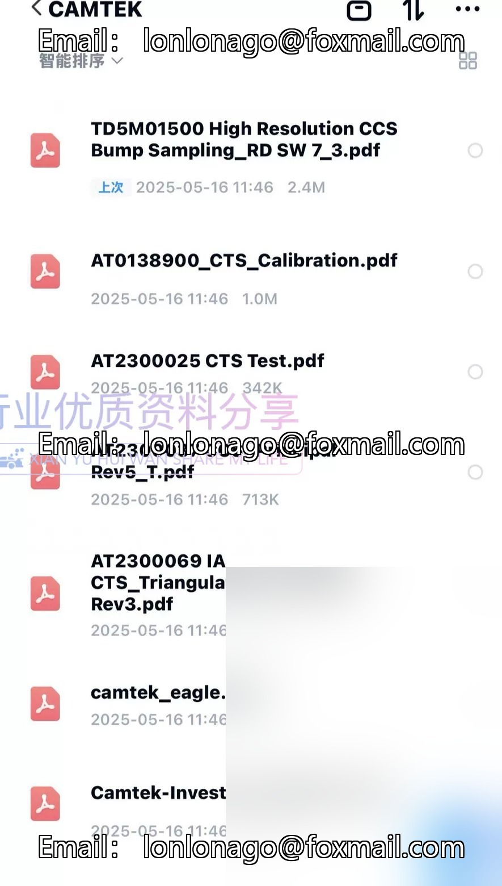
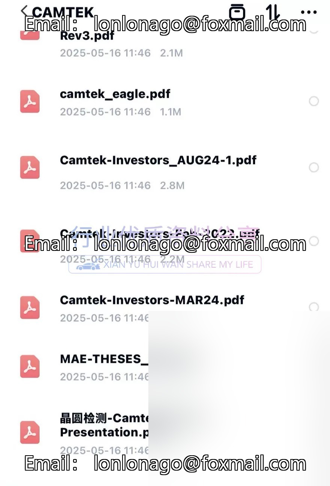

# Wafers Detachment Documents: CAMTEK Wafers Detachment: Equipment Manual Documents in several copies!!

## Body

Wafer detection materials: CAMTEK wafer detection: several copies of equipment manual materials!! CAMTEK is the best equipment for wafer detection. It is very valuable.
It has certain reference value! Launch now!!

Capture and send the electronic original directly! The following images include screenshots of the file portion. Please confirm before placing the order! Due to the replicable nature of electronic documentation Therefore, are allowed after purchase! Thanks for understanding!

For personal learning and reference only!

The materials include CAMTEK wafer detection equipment manuals and various files, including high-resolution, calibration and test documents, along with sorting, vision and content-sharing items.

<!-- AI_ENRICHED -->

## Images

## Payment

Here is a pay link on Stripe ( https://buy.stripe.com/3cs8yP7sY87d0vu9AB ). Please contact me lonlonago@foxmail.com after funding $89, and I will send you a complete data files , thank you!

